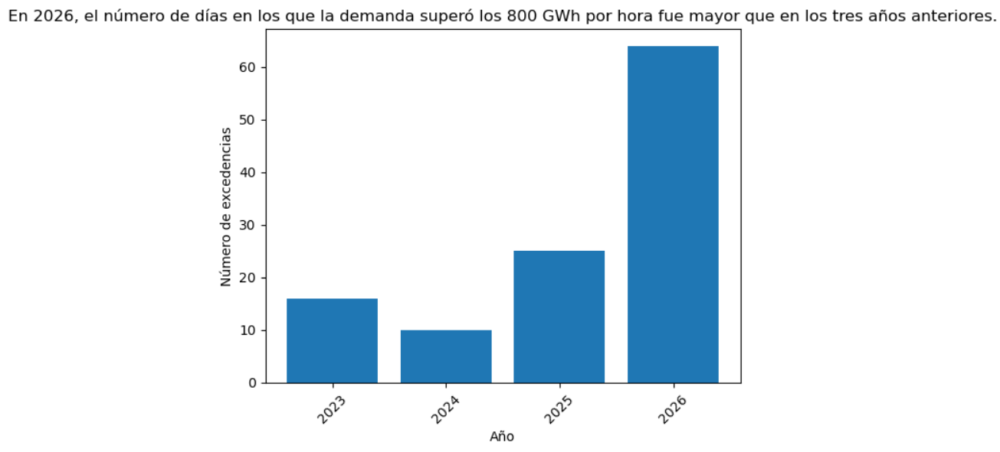

# Demanda eléctrica en España

### Prueba técnica · Analista de Datos

**Autora:** Taisiia Horobets  
**Proyecto:** Career Tech Hub · Prueba individual

---



## Resumen

Este proyecto analiza distintos aspectos de la demanda y la generación eléctrica en España a partir de los datos facilitados para la prueba técnica.

### Preguntas y resultados principales

| Pregunta | Respuesta | Conclusión |
|---|---|---|
| ¿Cuántos días superaron los 800 GWh de demanda? | 2023: 16; 2024: 10; 2025: 25; 2026: 64. | En 2026 hubo **64 días** por encima de 800 GWh, frente a **51 días en total** durante los tres años anteriores. |
| ¿Cómo cambia la demanda entre días laborables y días de descanso? | La demanda media en días de descanso fue entre un 13,55 % y un 14,44 % menor. | La diferencia se mantuvo relativamente estable durante el periodo analizado. |
| ¿Cuáles fueron los meses con mayor y menor demanda media? | Máximo: julio de 2026, con 814,83 GWh. Mínimo: abril de 2023, con 610,56 GWh. | La demanda media mensual más alta y más baja se registró en esos dos meses. |
| ¿Los cinco días más calurosos también tuvieron una demanda elevada? | La demanda de los cinco días superó la media general del periodo (693,18 GWh). | En esos días se observó una demanda superior a la media. Una posible explicación es el mayor uso de sistemas de refrigeración. |
| ¿Qué peso tiene la energía solar fotovoltaica en la generación total? | Su participación pasó del 14,21 % en 2023 al 22,40 % en 2026. | La participación aumentó **8,19 puntos porcentuales** entre 2023 y 2026. |
| ¿Qué ciudades registraron más días de lluvia? | Bilbao: 611; Barcelona: 350; Madrid: 305; Zaragoza: 269; Sevilla: 239; Valencia: 218. | Bilbao registró el mayor número de días con al menos 1 mm de lluvia entre las ciudades analizadas. |

### Interpretación general

Los resultados muestran que en 2026 se registraron más días con una demanda superior a 800 GWh que en los tres años anteriores juntos. También se observa un aumento de la participación de la energía solar fotovoltaica en la generación total. Estos resultados pueden servir como punto de partida para estudiar la evolución de la demanda y la importancia de seguir desarrollando fuentes de energía renovables.

### Límites del análisis

No se ha comprobado si los datos están completos para todos los años ni si existe el mismo número de registros para cada periodo. Por eso, antes de extraer conclusiones definitivas sobre la evolución anual, sería necesario revisar la cobertura de los datos y detectar posibles fechas ausentes.

Además, el análisis identifica patrones y diferencias, pero no demuestra por sí solo sus causas. Por ejemplo, la relación entre las temperaturas elevadas y una mayor demanda no permite afirmar que el uso de aire acondicionado sea la única causa.


---

## Los datos

### Archivos utilizados

- `datos/electricidad_para_panel.xlsx`: archivo Excel utilizado en la parte de análisis con pandas. Para esta prueba se utilizó la hoja `dias`.
- `datos/electricidad.db`: base de datos SQLite utilizada para las consultas SQL.

### Periodo

El análisis compara los años **2023, 2024, 2025 y 2026**, según los registros disponibles en los archivos.


**Fuente:** archivos de datos proporcionados para la prueba técnica. La fuente primaria de los datos no está especificada en el notebook.

**Limpieza:** no se realizó un proceso específico de limpieza de datos en este análisis.

---

## Tecnologías utilizadas

- Python
- Jupyter Notebook
- pandas
- NumPy
- Matplotlib
- SQLite
- SQL

---

## Estructura del repositorio

```text
prueba-tecnica_TechHUB/
│
├── datos/
│   ├── electricidad_para_panel.xlsx
│   └── electricidad.db
│
├── docs/
│   └── images/
│       └── bar_chart_cover.png
│
├── notebooks/
│   └── Prueba_individual_plantilla.ipynb
│
├── .gitignore
├── README.md
└── requirements.txt
```

---

## Cómo ejecutarlo

### 1. Clonar el repositorio

```bash
git clone https://github.com/mramoraf/prueba-tecnica-TechHUB.git
cd prueba-tecnica-TechHUB
```

### 2. Instalar las dependencias

Se recomienda utilizar un entorno virtual. Después, instala las bibliotecas necesarias:

```bash
pip install -r requirements.txt
```

### 3. Abrir Jupyter Notebook

```bash
jupyter notebook
```

Abre la carpeta `notebooks` y ejecuta `Prueba_individual_plantilla.ipynb`.

> **Importante:** antes de ejecutar el notebook en otro ordenador, sustituye las rutas locales absolutas de los archivos por rutas relativas al repositorio. Por ejemplo, si el directorio de trabajo es `notebooks`, puedes utilizar `../datos/electricidad_para_panel.xlsx` y `../datos/electricidad.db`.

---
